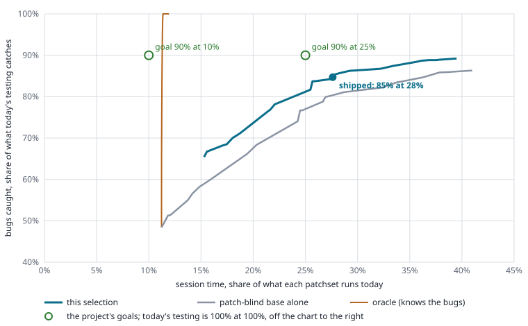

# How test selection works

Generated by `eval/explain.py` from the model trained 2026-10-21 on 4,142 patchsets. Every number below is computed, not typed; rerun `./testsel.py train && python3 eval/explain.py` to refresh it.

For a patchset, `testsel.py <change>` writes `Test-Parameters:` lines for the commit message.  They start with `trivial`, which replaces the full review matrix with one small session, and add custom sessions for the test sets below.  Autotest still runs its subtest-change sessions for any test the patch edits.

## The rules, in order

1. **Needs no testing**: documentation only (`Documentation/`, `lustre/doc/`, `contrib/`, `*.md`, `*.txt`, `README`, `LICENSE`, `ChangeLog`), or a patchset whose code Gerrit says is unchanged from the last one (only the commit message changed; the code was tested already): `trivial` alone, nothing else.
2. **Mandatory test sets**: each code area in the table below has test sets that belong to it.  A patch touching the area runs them, whatever the history or the budget says.  Test scripts are not an area's code (`sanity-hsm.sh` does not make a patch an HSM patch): the next rule covers them.
3. **Edited tests**: a patch that changes only test functions of test scripts (no helpers, not `test-framework.sh`, `cfg/` or `functions.sh`) runs just those tests: `testlist=<script> env=ONLY="<tests>"`.  Any other change to a test script runs the whole script.
4. **The patch-blind base**: the first 17 test sets of the order below, the same for every patch: the most that keeps `trivial` plus the base within 25% of today's session time.  Skipped when the patch changes only test scripts: it cannot break Lustre's code, only those scripts.
5. **History**: every test set that caught a bug on the last faulty patchset of the same change runs again.  Older history re-runs tests for bugs since fixed (E7).

Everything is a union: a test set picked by two rules runs once.  Test sets in one configuration share a session.

## How well it does

On the held-out months (1,201 patchsets of 605 changes, 923 bugs; the order fitted on the other months), the shipped selection catches **86% of the bugs today's testing catches, for 28% of its session time**.



`trivial` and Autotest's subtest-change sessions alone cost 10% of today's time and catch 49% of the bugs: every selection starts there, the oracle included, which is why its line rises straight up from that point.

Bugs are counted per change, every bug of a patchset (not one per patchset).  A bug's chance of being caught by a test set is how often that test set failed with it when it ran.  The oracle knows each patch's bugs and picks the cheapest tests that catch them: no predictor can beat it.

What each adopted step adds, as gain over the patch-blind line (points of bugs caught, averaged over 15 to 40% of cost; 95% intervals over changes).  Each row includes the ones above it:

| step (cumulative) | cross-validation | held-out months |
|---|---|---|
| E4: trivial, edited scripts whole, the blind base, all history | +1.7 (-0.4 to +4.0) | +2.8 (+0.9 to +5.2) |
| E6: + mandatory test sets; ONLY= for edited tests | +2.8 (+0.2 to +5.4) | +3.8 (+1.3 to +6.8) |
| E7: history from the last faulty patchset only | +3.6 (+1.5 to +6.2) | +4.5 (+2.1 to +7.6) |
| E8: test-only patches skip the base; test scripts are no area's code | +4.5 (+1.9 to +6.7) | +5.2 (+2.6 to +8.1) |

The registrations and results are in [eval/EXPERIMENTS.md](eval/EXPERIMENTS.md).

## Mandatory test sets

From `eval/predictors/principles.toml`.  A file matches an area by path prefix, or by a substring (`contains`).  These run in a DNE ldiskfs custom session unless the rule names other configurations.

| area | files | runs | why |
|---|---|---|---|
| client-pcc | `lustre/llite/pcc`, `lustre/utils/lpcc`, `lustre/utils/liblustreapi_pcc` | sanity-pcc (ldiskfs-dne) | persistent client cache |
| client-crypto | `lustre/llite/crypto`, `lustre/include/lustre_crypto` | sanity-sec (ldiskfs-dne) | client encryption is tested in sanity-sec |
| compression | `*compr*` | sanity-compr (ldiskfs-dne) | client-side data compression |
| layouts | `lustre/lov/`, `lustre/lod/` | sanity-pfl, sanity-flr (ldiskfs-dne) | file layouts: composite (PFL) and mirrored (FLR) layouts each have their own suite |
| erasure-coding | `lustre/ec/`, `*_ec.*`, `*/ec_*` | sanity-ec (ldiskfs-dne, zfs-dne) | erasure coded layouts: resync punches parity and finds data with SEEK_DATA/SEEK_HOLE, which the two backends do differently |
| pools | `*pool*` | ost-pools (ldiskfs-dne) | OST pools |
| dom | `*_dom*`, `*dom_*`, `*mdt_io*` | sanity-dom (ldiskfs-dne) | data on MDT |
| hsm | `*hsm*`, `*coordinator*` | sanity-hsm (ldiskfs-dne) | hierarchical storage management: the coordinator and copytool |
| lfsck | `lustre/lfsck/` | sanity-lfsck, sanity-scrub (ldiskfs-dne) | LFSCK and the OI scrub it drives; sanity runs namespace LFSCK over striped and remote directories too |
| quota | `lustre/quota/`, `*quota*`, `*lfs_project*` | sanity-quota (ldiskfs-dne, zfs-dne) | quota master and slaves, project quota; accounting is the backend's, so both backends |
| ldiskfs | `lustre/osd-ldiskfs/`, `ldiskfs/`, `lustre/kernel_patches/` | sanity-scrub (ldiskfs-dne, ldiskfs) | the ldiskfs backend: everything goes through it; OI scrub and mount/format paths are its own |
| security | `lustre/ptlrpc/gss/`, `lustre/ptlrpc/sec`, `lustre/ptlrpc/nodemap`, `lustre/utils/gss/`, `lustre/utils/l_getidentity`, `*nodemap*`, `*sptlrpc*` | sanity-sec (ldiskfs-dne) | RPC security, nodemaps and identity upcalls: sanity-sec, and the SELinux and shared-key sessions that only exist as their own group |
| kerberos | `lustre/ptlrpc/gss/`, `lustre/utils/gss/`, `*krb5*`, `*kerberos*` | sanity-krb5 (ldiskfs-dne) | Kerberos flavors of GSS |
| config-mount | `lustre/mgs/`, `lustre/mgc/`, `lustre/obdclass/obd_mount`, `lustre/obdclass/obd_config`, `lustre/utils/mount_`, `lustre/utils/mkfs_lustre`, `lustre/utils/lustre_cfg`, `lustre/utils/lctl`, `lustre/conf/` | conf-sanity (ldiskfs-dne) | configuration logs, mount, format and parameters; pool commands are the runtime config log updates every client must apply |
| lnet | `lnet/` | sanity-lnet, lnet-selftest (ldiskfs-dne) | the network layer: sanity-lnet for configuration, lnet-selftest for traffic, sanity as a client of it |
| nodemap | `*nodemap*` | sanity-sec (ldiskfs-dne) | nodemaps: sanity-quota's squash, tenant and admin nodemap tests wait for nodemap sync to the targets |
| lsnapshot | `*lsnapshot*`, `*snapshot*` | sanity-lsnapshot (zfs-dne) | snapshots need ZFS |

Exempt: a patch that needs no testing (rule 1).

## The cost model

Session time is what the eval counts, from finished review sessions since 2026-03-20:

- **Session setup**: 22 minutes per session (node provisioning plus Lustre initialization), paid once per configuration the selection uses.
- **A test set**: the mean time of that script in that configuration.  An ONLY= line costs the script's time times the share of its subtests asked for.
- **Always run**: the `trivial` session (4.6 hours) and Autotest's subtest-change sessions, which run when a patch edits tests.
- **Today**: every session the patchset's build actually ran; 118.2 hours on average over the 2,129 randomly sampled patchsets.
- **Budget**: the blind base is cut where trivial plus the base would pass 25% of today's time on those patchsets.  Mandatory sets, edited tests and history come on top, so a patch's own cost varies.

The patch-blind base, priced:

```
trivial           276 min
ldiskfs-dne       754 min  lnet-selftest mds-survey parallel-scale-nfsv3 racer sanity sanity-dom sanity-ec sanity-flr sanity-hsm sanity-lfsck sanity-lnet sanity-pfl sanity-sec sanityn
zfs               150 min  sanity-flr sanity-lsnapshot sanity-quota
total            1181 min  (19.7 h; today 118.2 h)
```

Configurations and the keys that ask for them:

| configuration | Test-Parameters keys | what it is |
|---|---|---|
| ldiskfs-dne | (default) | ldiskfs, 2 MDS with 4 MDTs, 8 OSTs: a custom session's default (review-dne-part-N, review-ldiskfs-dne) |
| zfs-dne | `fstype=zfs` | ZFS, 2 MDS with 4 MDTs (review-dne-zfs-part-N) |
| ldiskfs-dne-arm | `clientarch=aarch64 clientdistro=rocky9.8` | aarch64 clients, DNE (review-ldiskfs-dne-arm) |
| ldiskfs | `mdscount=1 mdtcount=1 ostcount=7` | ldiskfs, one MDT, 7 OSTs (review-ldiskfs) |
| zfs | `fstype=zfs mdscount=1 mdtcount=1 ostcount=2` | ZFS, one MDT, 2 OSTs (review-zfs) |
| ldiskfs-arm | `clientarch=aarch64 clientdistro=rocky9.8 mdscount=1 mdtcount=1 ostcount=7` | aarch64 clients, one MDT (review-ldiskfs-arm) |
| ldiskfs-ubuntu | `clientdistro=ubuntu2404 mdscount=1 mdtcount=1 ostcount=7` | Ubuntu clients (review-ldiskfs-ubuntu) |
| ldiskfs-sles | `clientdistro=sles15sp5 mdscount=1 mdtcount=1 ostcount=7` | SLES clients (review-ldiskfs on SLES) |
| ldiskfs-dne-selinux-ssk | testgroup= only | SELinux and shared-secret keys, DNE (review-dne-selinux-ssk-part-N): testgroup= only, which runs the group's suites |
| ldiskfs-dne-ipv6 | testgroup= only | IPv6, DNE (review-dne-ipv6): testgroup= only |

## The order test sets are added in

The patch-blind base ranked greedily: each step adds the test set that catches the most bugs not yet caught per second it adds (its run time, plus a session's setup when its configuration has none yet).  Only test sets the review matrix runs (the review groups of the last 30 days) are candidates.  Ranked on all 4,142 patchsets.  **The line marks the budget: the first 17 run on every patch.**

| # | test set | configuration | minutes | adds | cost so far | bugs so far |
|---|---|---|---|---|---|---|
| 0 | *trivial and subtest-change sessions alone* | | | | 10% | 49% |
| 1 | sanity-flr | zfs | 12 + setup | 2.6% | 11% | 53% |
| 2 | sanity-lsnapshot | zfs | 3 | 0.5% | 11% | 53% |
| 3 | sanity-dom | ldiskfs-dne | 16 + setup | 1.1% | 11% | 55% |
| 4 | sanity-flr | ldiskfs-dne | 20 | 1.1% | 12% | 56% |
| 5 | mds-survey | ldiskfs-dne | 4 | 0.2% | 12% | 56% |
| 6 | racer | ldiskfs-dne | 13 | 0.6% | 12% | 57% |
| 7 | sanity-lnet | ldiskfs-dne | 31 | 1.0% | 12% | 58% |
| 8 | lnet-selftest | ldiskfs-dne | 6 | 0.2% | 13% | 58% |
| 9 | sanity-hsm | ldiskfs-dne | 46 | 1.2% | 13% | 60% |
| 10 | sanityn | ldiskfs-dne | 110 | 2.5% | 15% | 63% |
| 11 | sanity-ec | ldiskfs-dne | 23 | 0.5% | 15% | 64% |
| 12 | sanity-pfl | ldiskfs-dne | 39 | 0.8% | 16% | 65% |
| 13 | sanity | ldiskfs-dne | 250 | 5.2% | 19% | 71% |
| 14 | sanity-sec | ldiskfs-dne | 98 | 1.9% | 21% | 74% |
| 15 | parallel-scale-nfsv3 | ldiskfs-dne | 21 | 0.4% | 21% | 74% |
| 16 | sanity-quota | zfs | 113 | 1.8% | 22% | 76% |
| 17 | sanity-lfsck | ldiskfs-dne | 55 | 0.9% | 23% | 77% |
| | **budget: the base stops here** | | | | | |
| 18 | testgroup=review-dne-selinux-ssk-part-2 | ldiskfs-dne-selinux-ssk | 272 | 2.9% | 27% | 81% |
| 19 | lustre-rsync-test | ldiskfs-dne | 14 | 0.2% | 27% | 81% |
| 20 | obdfilter-survey | ldiskfs-dne | 4 | 0.0% | 27% | 81% |
| 21 | sanity-pcc | ldiskfs-dne | 64 | 0.6% | 28% | 82% |
| 22 | ost-pools | ldiskfs-dne | 37 | 0.3% | 29% | 82% |
| 23 | sanity-scrub | ldiskfs-dne | 68 | 0.5% | 30% | 83% |
| 24 | replay-vbr | ldiskfs-dne | 38 | 0.3% | 30% | 83% |
| 25 | pjdfstest | zfs-dne | 22 + setup | 0.3% | 31% | 84% |
| 26 | sanity | zfs-dne | 243 | 1.8% | 34% | 86% |
| 27 | mmp | zfs-dne | 0 | 0.0% | 34% | 86% |
| 28 | replay-single | zfs-dne | 152 | 1.0% | 36% | 87% |
| 29 | replay-ost-single | ldiskfs-dne | 13 | 0.1% | 36% | 87% |
| 30 | lustre-rsync-test | zfs-dne | 14 | 0.1% | 37% | 88% |
| 31 | sanity-quota | ldiskfs-dne | 147 | 0.8% | 39% | 89% |
| 32 | sanity-dom | zfs-dne | 15 | 0.1% | 39% | 89% |
| 33 | sanityn | zfs-dne | 97 | 0.5% | 40% | 89% |
| 34 | replay-dual | ldiskfs-dne | 50 | 0.3% | 41% | 90% |
| 35 | sanity-sec | ldiskfs-arm | 79 + setup | 0.5% | 42% | 90% |
| 36 | sanity-flr | zfs-dne | 20 | 0.1% | 43% | 90% |
| 37 | sanity-lfsck | zfs-dne | 50 | 0.2% | 43% | 91% |
| 38 | conf-sanity | ldiskfs-dne | 546 | 2.2% | 51% | 93% |
| 39 | sanity-pcc | zfs-dne | 61 | 0.2% | 52% | 94% |
| 40 | sanity-hsm | zfs-dne | 47 | 0.2% | 53% | 94% |
| 41 | sanity-sec | zfs-dne | 103 | 0.3% | 54% | 94% |
| 42 | replay-ost-single | zfs | 13 | 0.0% | 54% | 94% |
| 43 | parallel-scale | ldiskfs-dne | 41 | 0.1% | 55% | 95% |
| 44 | testgroup=review-dne-selinux-ssk-part-1 | ldiskfs-dne-selinux-ssk | 296 | 0.9% | 59% | 96% |
| 45 | recovery-small | zfs-dne | 110 | 0.3% | 61% | 96% |
| 46 | sanity-sec | ldiskfs-ubuntu | 98 + setup | 0.3% | 62% | 96% |
| 47 | sanity-lnet | ldiskfs-ubuntu | 33 | 0.1% | 63% | 97% |

*adds*: the share of the history's bugs this step catches that earlier steps did not.  *cost so far* is on the random sample; *bugs so far* on the history it was ranked on, so it flatters the order (the chart above is held out).

## Examples

Held-out patchsets, one of each kind the rules treat differently.

### documentation only: 58593/3

LU-13726 build: fix checkpatch fix matching  
Files: `contrib/scripts/spelling.txt`, `contrib/scripts/checkpatch.pl`  

```
Test-Parameters: trivial
```
- needs no testing

Cost: 4.6 hours, of which 4.6 are the trivial and subtest-change sessions as they ran on that build.  Today's run: 16.3 hours.

### only the commit message changed: 52165/32

LU-13814 clio: add osc_dio_pages_init  
Files: `lustre/include/cl_object.h`, `lustre/osc/osc_page.c`, `lustre/include/lustre_osc.h`, `lustre/mdc/mdc_dev.c`, `lustre/osc/osc_object.c`, `lustre/osc/osc_cache.c`  

```
Test-Parameters: trivial
```
- needs no testing

Cost: 14.4 hours, of which 14.4 are the trivial and subtest-change sessions as they ran on that build.  Today's run: 164.1 hours.

### changes only test functions: 56693/3

LU-18341 tests: skip sanity-flr/test_36 for new servers  
Files: `lustre/tests/sanity-flr.sh`  

```
Test-Parameters: trivial
Test-Parameters: testlist=sanity-flr env=ONLY="36"
```
- edits only tests: sanity-flr 1
- changes only test scripts: no patch-blind base

Cost: 5.8 hours, of which 5.4 are the trivial and subtest-change sessions as they ran on that build.  Today's run: 11.2 hours.

### changes HSM code: 69619/1

LU-20118 hsm: return EINVAL when archive ID requires HS_EXISTS  
Files: `lustre/tests/sanity-hsm.sh`, `lustre/mdt/mdt_hsm.c`  

```
Test-Parameters: trivial
Test-Parameters: testlist=lnet-selftest,mds-survey,parallel-scale-nfsv3,racer,sanity,sanity-dom,sanity-ec,sanity-flr,sanity-hsm,sanity-lfsck,sanity-lnet,sanity-pfl,sanity-sec,sanityn
Test-Parameters: fstype=zfs mdscount=1 mdtcount=1 ostcount=2 testlist=sanity-flr,sanity-lsnapshot,sanity-quota
```
- hsm must run sanity-hsm: lustre/mdt/mdt_hsm.c
- the first 17 test sets of the patch-blind order

Cost: 36.1 hours, of which 21.1 are the trivial and subtest-change sessions as they ran on that build.  Today's run: 176.3 hours.

### changes code with a must list: 37246/17

LU-13139 obdclass: collect stats for OSD methods  
Files: `lustre/lod/lproc_lod.c`, `lustre/obdclass/dt_object.c`, `lustre/lod/lod_object.c`, `lustre/osd-zfs/osd_lproc.c`, `lustre/quota/qmt_dev.c`, `lustre/include/dt_object.h` and 1 more  

```
Test-Parameters: trivial
Test-Parameters: mdscount=1 mdtcount=1 ostcount=7 testlist=sanity-scrub
Test-Parameters: testlist=lnet-selftest,mds-survey,parallel-scale-nfsv3,racer,sanity,sanity-dom,sanity-ec,sanity-flr,sanity-hsm,sanity-lfsck,sanity-lnet,sanity-pfl,sanity-quota,sanity-scrub,sanity-sec,sanityn
Test-Parameters: fstype=zfs mdscount=1 mdtcount=1 ostcount=2 testlist=sanity-flr,sanity-lsnapshot,sanity-quota
Test-Parameters: fstype=zfs testlist=sanity-quota
```
- layouts must run sanity-pfl, sanity-flr: lustre/lod/lproc_lod.c
- quota must run sanity-quota: lustre/quota/qmt_dev.c
- ldiskfs must run sanity-scrub: lustre/osd-ldiskfs/osd_lproc.c
- the first 17 test sets of the patch-blind order

Cost: 39.7 hours, of which 17.0 are the trivial and subtest-change sessions as they ran on that build.  Today's run: 133.7 hours.

### caught on an earlier patchset: 35287/29

LU-12550 ldlm: contention detection  
Files: `lustre/utils/wirecheck.c`, `lustre/obdclass/class_obd.c`, `lustre/include/lustre_export.h`, `lustre/utils/wiretest.c`, `lustre/include/obd_support.h`, `Documentation/man4/ldlm.namespaces.contention_seconds.4` and 12 more  
Earlier faulty patchsets: 6  

```
Test-Parameters: trivial
Test-Parameters: testlist=lnet-selftest,mds-survey,parallel-scale-nfsv3,racer,sanity,sanity-dom,sanity-ec,sanity-flr,sanity-hsm,sanity-lfsck,sanity-lnet,sanity-pfl,sanity-sec,sanityn
Test-Parameters: fstype=zfs mdscount=1 mdtcount=1 ostcount=2 testlist=sanity-flr,sanity-lsnapshot,sanity-quota
Test-Parameters: fstype=zfs testlist=sanityn
```
- the first 17 test sets of the patch-blind order
- caught a bug on the last faulty patchset: sanityn|ldiskfs-dne, sanityn|zfs-dne (6 faulty patchsets in all)

Cost: 22.2 hours, of which 5.1 are the trivial and subtest-change sessions as they ran on that build.  Today's run: 131.7 hours.

## Patch risk

`testsel.py` also scores how likely the patch is to carry a bug CI would catch: a logistic model on patch signals (`signals/`), fitted to the population (base rate 19%).  Tiers by percentile of the population: high from the 85th (a score of 33%), medium from the 50th (12%), low below.  Risk does not change the selection (spending by risk lost in E2); it is for routing review.

Weights, on standardized signals (positive raises the risk):

| signal | weight | what it measures |
|---|---|---|
| gerrit_kind.trivial_rebase | -0.54 | Gerrit's kind of patchset: rework, trivial rebase, message only, no change. |
| change_history.faulty_patchsets | +0.51 | What CI caught on this change's earlier patchsets: how many were faulty, and the last. |
| lines_changed | +0.31 | Lines added or removed by the diff (log scale). |
| change_history.last_faulty | +0.31 | What CI caught on this change's earlier patchsets: how many were faulty, and the last. |
| components | +0.26 | Top-level components it spans, e.g. lustre/llite (log scale). |
| docs_only | -0.25 | Changes only documentation or contrib. |
| gerrit_kind.rework | -0.22 | Gerrit's kind of patchset: rework, trivial rebase, message only, no change. |
| gerrit_kind.no_code_change | -0.21 | Gerrit's kind of patchset: rework, trivial rebase, message only, no change. |
| areas.kernel-compat | -0.20 | Sensitive areas the patch touches (signals/areas.toml), one column each. |
| tests_only | +0.20 | Changes only test scripts. |
| files_changed | -0.12 | Files the patch changes (log scale). |
| areas.data-integrity | +0.12 | Sensitive areas the patch touches (signals/areas.toml), one column each. |
| component_fault_rate.mean | +0.11 | Past fault rate of the components the patch touches (riskiest, and mean). |
| areas.on-disk-format | -0.11 | Sensitive areas the patch touches (signals/areas.toml), one column each. |
| gerrit_kind.no_change | -0.10 | Gerrit's kind of patchset: rework, trivial rebase, message only, no change. |
| functions_changed | -0.09 | C functions whose bodies the patch changes (log scale). |
| areas.memory-lifetime | +0.07 | Sensitive areas the patch touches (signals/areas.toml), one column each. |
| gerrit_kind.trivial_rebase_with_message_update | -0.05 | Gerrit's kind of patchset: rework, trivial rebase, message only, no change. |
| component_fault_rate.max | +0.03 | Past fault rate of the components the patch touches (riskiest, and mean). |
| areas.security | -0.02 | Sensitive areas the patch touches (signals/areas.toml), one column each. |
| sensitive_count | -0.02 | How many sensitive areas the patch touches. |
| areas.locking | +0.02 | Sensitive areas the patch touches (signals/areas.toml), one column each. |
| areas.wire-protocol | -0.02 | Sensitive areas the patch touches (signals/areas.toml), one column each. |

