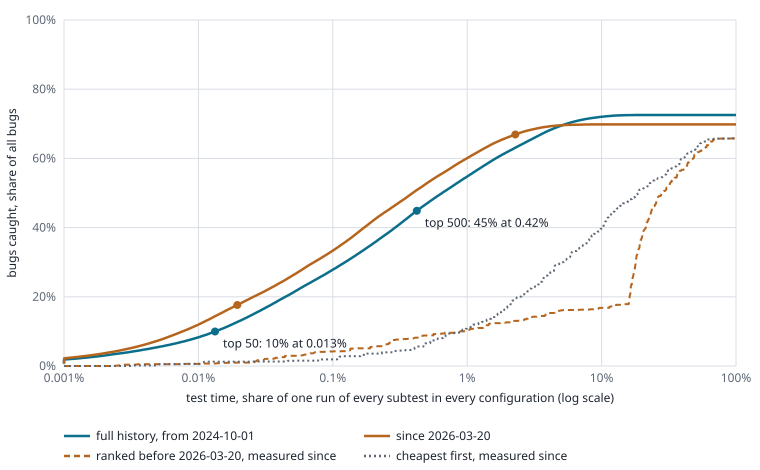

# The subtest stack

Generated by `eval/subtests.py` from the eval's bugs (`eval/cases.py`, on `data/failures.db`) and Rainshadow's per-subtest timings (fetched 2026-11-05).  Every number below is computed; rerun `eval/subtests.py --fetch` to refresh it.  The page version, sortable and with the full stack: [docs/subtest-stack.html](docs/subtest-stack.html).

Every subtest in every configuration, ranked greedily: each step adds the subtest that catches the most bugs not yet caught per second of its own run time.  A bug one pick catches no longer counts for the picks after it.  This is the test-set order of [HOW_IT_WORKS.md](HOW_IT_WORKS.md) one level down: what each subtest is worth for its own time.



## How it is counted

- **Bugs** are the eval's (`eval/bugs.py`, `eval/cases.py`): a patchset's faults grouped into bugs, a series' inherited bugs left to the change that brought them, and each change counting once (a change with three bugs gives each a third).  Shares of bugs are of all of them.
- **A catch**: a subtest in a configuration catches a bug when it failed with it in a session of that configuration on the patchset, however that failure was triaged (as `eval/cases.py` credits a script).  Its chance of catching it is the share of the sessions running its script there in which it failed; nearly all are 1.  Developers' custom sessions count for nothing, as in the eval.
- **Whiteout**, as in the test-set order: a pick lowers each bug's chance of still being missed, and the picks after it are credited only with what is left.
- **Time** is Rainshadow's per-subtest timings (`rainshadow timings tests --by-group`) over the same window, from lustre-reviews' review groups, each group's runs split over the configurations its sessions ran in.  The subtest-change groups are left out of the time: they repeat each edited test dozens of times for that patch.  A subtest's time is its own run: not its script's setup and cleanup, nor a session's.  Running a few subtests alone (`ONLY=`) still pays those, so the head of the stack is cheaper here than it would be in CI.

## What it shows

**Full history** (2024-10-01 to 2026-10-21): 3,134 bugs of 748 changes, 19,153 subtests in their configurations.

| top | share of bugs | minutes, one run of each | share of the time | share of CI's subtest hours today |
|---|---|---|---|---|
| 10 | 3.6% | 0.3 | 0.0025% | 0.0066% |
| 50 | 10.0% | 1.5 | 0.013% | 0.024% |
| 100 | 17.0% | 3.7 | 0.032% | 0.047% |
| 200 | 26.4% | 10.0 | 0.087% | 0.13% |
| 500 | 44.8% | 48.4 | 0.42% | 0.59% |
| 1000 | 60.5% | 198.0 | 1.7% | 2.2% |
| 2000 | 72.4% | 1,498.4 | 13.0% | 14.2% |
| all 19,153 | 72.6% | 11,489 | 100% | 100% |

**Since the matrix changed** (2026-03-20 to 2026-10-21): 902 bugs of 267 changes, 18,377 subtests in their configurations.

| top | share of bugs | minutes, one run of each | share of the time | share of CI's subtest hours today |
|---|---|---|---|---|
| 10 | 4.5% | 0.2 | 0.0026% | 0.0019% |
| 50 | 17.6% | 1.8 | 0.019% | 0.020% |
| 100 | 29.0% | 6.2 | 0.066% | 0.062% |
| 200 | 44.6% | 23.4 | 0.25% | 0.21% |
| 500 | 66.9% | 215.4 | 2.3% | 1.9% |
| 1000 | 69.8% | 1,197.4 | 12.7% | 10.2% |
| 2000 | 69.8% | 1,287.2 | 13.6% | 11.4% |
| all 18,377 | 69.8% | 9,457 | 100% | 100% |

Both tables are in-sample: each stack is ranked on the bugs it is measured on, which flatters it.  Ranked on the bugs before 2026-03-20 and measured on the bugs since (the dashed line in the chart), the top 50 catch 1%, the top 500 9%, the top 1,000 13%, the top 2,000 19% of the later bugs, where the recent window's own top 500 catch 67%.  A subtest's past catches say little about its next ones: of the 10,075 subtests in their configurations that ever caught a bug, 55% caught bugs of one change only.  And 63% of bugs can be caught in more than one place (the same subtest in another configuration, or other subtests the patch broke too), so the cheapest of them will do: past the head, an order that knows nothing of bugs, cheapest subtest first (the dotted line), does better on the later bugs, 10% against 11% at 1% of the time, 16% against 30% at 5% of the time, 17% against 40% at 10% of the time, 47% against 54% at 25% of the time.  The head of the stack is a guide to where catches have come from, not a list to run.

Running every subtest once in every configuration catches 73% of the bugs.  Of the rest, 14% failed in no review session (only in developers' custom sessions or interop runs, which the eval credits to no configuration either), 2% failed only as a whole script (a crash or timeout outside any subtest, which no one subtest owns), and the remainder failed in only some of the sessions that ran them, so one run catches them only that often.

*Minutes, one run of each*: the stack so far, each subtest run once.  *Share of the time*: that against one run of every subtest in every configuration.  *Share of CI's subtest hours today* weighs each subtest by how often CI ran it in the last 30 days.

## Configurations

A subtest is ranked per configuration: the eval's classes (`eval/classes.py`), which are what `Test-Parameters` can ask for.  The same test catches different bugs on ZFS and ldiskfs, with one MDT and with four, and costs differently in each (DNE runs the remote directory paths, ZFS the OSD's own), so pooling them would hide where a catch comes from and price it wrongly.  Distro is not a configuration except where the eval makes it one (Ubuntu and SLES clients, aarch64).  Share of the stack's catches per configuration:

| configuration | full history | since 2026-03-20 |
|---|---|---|
| ldiskfs-dne | 38.9% | 31.0% |
| zfs-dne | 27.3% | 31.3% |
| ldiskfs-dne-selinux-ssk | 8.8% | 8.6% |
| zfs | 6.7% | 6.2% |
| ldiskfs | 5.7% | 4.6% |
| ldiskfs-arm | 3.9% | 8.0% |
| ldiskfs-dne-arm | 3.2% | 6.7% |
| ldiskfs-ubuntu | 2.4% | 1.6% |
| ldiskfs-sles | 1.6% | 0.4% |
| ldiskfs-dne-ipv6 | 1.5% | 1.6% |

## The top 200, full history

| # | suite | subtest | configuration | mean s | runs per 30 days | adds | bugs so far | time so far | caught | only it | bugs per 1,000 h |
|---|---|---|---|---|---|---|---|---|---|---|---|
| 1 | sanity-flr | test_62 | zfs | 1.6 | 1,242 | 5.14 | 0.7% | 0.00023% | 5.14 | 0.00 | 1073.4 |
| 2 | sanity-dom | test_1 | ldiskfs-dne | 1.6 | 5,389 | 3.32 | 1.1% | 0.00047% | 3.32 | 0.00 | 150.6 |
| 3 | sanity | test_909 | ldiskfs-dne-selinux-ssk | 1.8 | 1,409 | 2.83 | 1.5% | 0.00073% | 2.83 | 0.00 | 717.4 |
| 4 | sanity | test_24u | zfs-dne | 1.9 | 2,714 | 2.67 | 1.9% | 0.0010% | 2.67 | 0.00 | 304.0 |
| 5 | sanity | test_4 | ldiskfs-dne | 1.5 | 3,683 | 2.04 | 2.1% | 0.0012% | 2.04 | 0.00 | 126.3 |
| 6 | replay-vbr | test_0b | ldiskfs-dne | 2.0 | 2,598 | 2.57 | 2.5% | 0.0015% | 2.57 | 1.00 | 183.6 |
| 7 | sanity-flr | test_212b | ldiskfs-dne | 1.9 | 2,674 | 2.42 | 2.8% | 0.0018% | 2.42 | 0.50 | 287.1 |
| 8 | sanity | test_104d | ldiskfs-dne | 1.6 | 3,672 | 2.00 | 3.1% | 0.0020% | 2.00 | 0.00 | 118.4 |
| 9 | sanity | test_102p | ldiskfs-dne | 1.7 | 3,676 | 2.00 | 3.3% | 0.0023% | 2.00 | 0.00 | 114.1 |
| 10 | sanity | test_27H | ldiskfs-dne | 1.7 | 3,683 | 1.73 | 3.6% | 0.0025% | 2.16 | 0.00 | 121.9 |
| 11 | sanity-flr | test_0m | zfs | 1.3 | 1,243 | 1.25 | 3.7% | 0.0027% | 1.25 | 0.00 | 742.2 |
| 12 | sanity | test_27X | ldiskfs-dne | 1.9 | 3,677 | 1.75 | 4.0% | 0.0030% | 2.04 | 1.00 | 135.0 |
| 13 | sanityn | test_6 | ldiskfs-dne | 1.6 | 1,583 | 1.43 | 4.2% | 0.0032% | 1.43 | 0.00 | 145.2 |
| 14 | sanity | test_17b | ldiskfs-dne-selinux-ssk | 1.5 | 1,420 | 1.29 | 4.3% | 0.0034% | 1.95 | 0.00 | 439.4 |
| 15 | sanity | test_190c | ldiskfs-arm | 1.6 | 1,350 | 1.34 | 4.5% | 0.0037% | 1.34 | 0.00 | 513.4 |
| 16 | sanity-quota | test_49b | zfs | 1.2 | 1,243 | 1.00 | 4.6% | 0.0038% | 1.00 | 0.00 | 375.2 |
| 17 | sanity | test_910 | zfs-dne | 2.3 | 2,652 | 1.78 | 4.9% | 0.0042% | 1.78 | 0.02 | 242.1 |
| 18 | sanity-flr | test_3 | ldiskfs-dne | 1.7 | 2,695 | 1.25 | 5.1% | 0.0044% | 1.33 | 0.00 | 115.7 |
| 19 | sanityn | test_117i | zfs-dne | 1.3 | 0 | 1.00 | 5.2% | 0.0046% | 1.00 | 1.00 |  |
| 20 | sanity | test_300ug | ldiskfs-dne-selinux-ssk | 2.6 | 1,417 | 1.81 | 5.4% | 0.0050% | 1.81 | 0.00 | 241.4 |
| 21 | sanity | test_300m | ldiskfs | 1.8 | 4,002 | 1.25 | 5.6% | 0.0052% | 1.39 | 0.00 | 94.3 |
| 22 | sanity | test_58 | ldiskfs-dne-selinux-ssk | 1.4 | 1,418 | 1.00 | 5.7% | 0.0054% | 1.00 | 0.00 | 232.4 |
| 23 | sanity-flr | test_213b | zfs | 1.5 | 157 | 1.00 | 5.9% | 0.0057% | 1.00 | 0.00 |  |
| 24 | sanity-lnet | test_26 | ldiskfs | 1.6 | 4,010 | 1.06 | 6.0% | 0.0059% | 1.06 | 0.00 | 79.4 |
| 25 | sanity | test_56Ec | ldiskfs-dne-arm | 1.5 | 568 | 1.00 | 6.1% | 0.0061% | 1.00 | 0.00 | 955.7 |
| 26 | parallel-scale-nfsv3 | test_iorfpp | ldiskfs-dne | 2.7 | 104 | 1.79 | 6.4% | 0.0065% | 1.79 | 1.25 | 170.7 |
| 27 | sanity | test_56cb | ldiskfs-dne | 1.6 | 0 | 1.00 | 6.5% | 0.0067% | 1.00 | 0.00 |  |
| 28 | sanity | test_17a | ldiskfs | 1.7 | 4,008 | 1.08 | 6.7% | 0.0070% | 1.33 | 0.00 | 91.7 |
| 29 | sanityn | test_100e | zfs-dne | 1.6 | 1,574 | 1.00 | 6.8% | 0.0072% | 1.00 | 0.00 | 164.3 |
| 30 | sanity | test_300k | ldiskfs-dne-selinux-ssk | 2.1 | 1,418 | 1.25 | 7.0% | 0.0075% | 1.25 | 0.00 | 207.5 |
| 31 | sanity | test_27X | ldiskfs-arm | 1.7 | 1,350 | 1.00 | 7.1% | 0.0078% | 1.00 | 0.00 | 355.9 |
| 32 | sanity-ec | test_31c | zfs-dne | 1.8 | 1,451 | 1.08 | 7.2% | 0.0080% | 1.08 | 0.00 | 736.8 |
| 33 | sanity-flr | test_212d | ldiskfs-dne | 1.6 | 0 | 0.95 | 7.4% | 0.0082% | 0.95 | 0.00 |  |
| 34 | parallel-scale-nfsv3 | test_cleanup | ldiskfs-dne | 1.4 | 104 | 0.83 | 7.5% | 0.0085% | 0.83 | 0.33 | 154.9 |
| 35 | sanity-ec | test_4b | zfs-dne | 1.7 | 1,453 | 1.02 | 7.6% | 0.0087% | 1.02 | 0.00 | 721.7 |
| 36 | sanity-dom | test_131b | ldiskfs-dne | 2.0 | 2,694 | 1.17 | 7.8% | 0.0090% | 1.17 | 0.00 | 85.3 |
| 37 | sanity | test_23e | ldiskfs-dne | 1.7 | 3,574 | 1.00 | 7.9% | 0.0092% | 1.00 | 0.00 | 315.8 |
| 38 | sanity-pfl | test_19c | zfs-dne | 2.1 | 2,558 | 1.19 | 8.1% | 0.0095% | 1.19 | 0.00 | 127.0 |
| 39 | sanity | test_56rd | ldiskfs-dne-selinux-ssk | 1.5 | 1,418 | 0.86 | 8.2% | 0.0098% | 0.97 | 0.00 | 217.7 |
| 40 | sanity | test_24Ka | ldiskfs-arm | 1.8 | 0 | 1.00 | 8.3% | 0.010% | 1.00 | 0.00 |  |
| 41 | sanity-flr | test_44b | ldiskfs-dne | 1.8 | 2,693 | 1.01 | 8.4% | 0.010% | 1.01 | 0.00 | 82.0 |
| 42 | sanity-lnet | test_475 | ldiskfs-dne | 2.1 | 2,650 | 1.17 | 8.6% | 0.011% | 1.17 | 0.00 | 298.1 |
| 43 | sanity | test_0d | ldiskfs-dne | 3.6 | 3,683 | 2.00 | 8.9% | 0.011% | 4.08 | 2.00 | 107.6 |
| 44 | sanityn | test_112 | ldiskfs-dne | 2.2 | 1,575 | 1.22 | 9.0% | 0.011% | 1.22 | 0.00 | 90.2 |
| 45 | sanity | test_398t | ldiskfs-dne-selinux-ssk | 1.9 | 1,417 | 1.04 | 9.2% | 0.012% | 1.04 | 0.00 | 462.7 |
| 46 | sanity | test_56El | ldiskfs-dne-selinux-ssk | 1.8 | 1,071 | 1.00 | 9.3% | 0.012% | 1.00 | 0.00 |  |
| 47 | sanityn | test_117a | ldiskfs-dne | 3.1 | 0 | 1.67 | 9.5% | 0.012% | 1.67 | 0.00 |  |
| 48 | sanity | test_400b | ldiskfs-dne | 2.3 | 3,673 | 1.25 | 9.7% | 0.013% | 1.25 | 0.25 | 52.4 |
| 49 | sanity | test_215 | ldiskfs-dne | 1.9 | 3,676 | 1.00 | 9.8% | 0.013% | 1.14 | 0.00 | 59.5 |
| 50 | sanity-lnet | test_219 | ldiskfs-dne-ipv6 | 1.9 | 1,406 | 1.02 | 10.0% | 0.013% | 1.07 | 0.00 | 217.2 |
| 51 | sanity-flr | test_62 | zfs-dne | 1.9 | 2,632 | 1.00 | 10.1% | 0.014% | 6.06 | 0.00 | 703.2 |
| 52 | sanity | test_430aa | ldiskfs | 1.9 | 0 | 1.00 | 10.2% | 0.014% | 1.00 | 0.00 |  |
| 53 | sanity-flr | test_50c | zfs | 1.4 | 1,246 | 0.72 | 10.3% | 0.014% | 0.97 | 0.07 | 227.9 |
| 54 | sanity | test_0 | ldiskfs-dne | 2.0 | 0 | 1.00 | 10.5% | 0.014% | 1.00 | 0.00 |  |
| 55 | sanity-lnet | test_218 | ldiskfs-arm | 1.0 | 0 | 0.50 | 10.5% | 0.014% | 0.50 | 0.00 |  |
| 56 | sanity-sec | test_1 | ldiskfs-arm | 2.0 | 0 | 1.00 | 10.7% | 0.015% | 1.00 | 0.00 |  |
| 57 | sanity | test_127a | ldiskfs-dne | 2.0 | 3,676 | 1.00 | 10.8% | 0.015% | 1.00 | 1.00 | 47.4 |
| 58 | sanity | test_56da | ldiskfs-dne | 2.6 | 5 | 1.29 | 11.0% | 0.015% | 1.30 | 0.00 | 82.3 |
| 59 | sanity | test_229 | ldiskfs-dne-selinux-ssk | 1.7 | 1,418 | 0.83 | 11.1% | 0.016% | 1.07 | 0.00 | 214.4 |
| 60 | sanity-sec | test_65 | ldiskfs-ubuntu | 4.7 | 1,252 | 2.28 | 11.4% | 0.016% | 2.28 | 0.00 | 116.3 |
| 61 | sanity | test_103g | ldiskfs-dne | 2.0 | 3,671 | 0.96 | 11.5% | 0.017% | 0.96 | 0.17 | 118.3 |
| 62 | sanity-lnet | test_219 | ldiskfs-dne-arm | 2.5 | 567 | 1.20 | 11.7% | 0.017% | 1.20 | 0.00 | 334.7 |
| 63 | sanity-hsm | test_1A | zfs-dne | 2.5 | 2,649 | 1.18 | 11.8% | 0.017% | 1.18 | 0.00 | 103.6 |
| 64 | sanity | test_814 | zfs-dne | 2.1 | 2,656 | 1.00 | 12.0% | 0.018% | 1.00 | 0.00 | 110.1 |
| 65 | sanity | test_56xC | zfs-dne | 2.5 | 2,707 | 1.17 | 12.1% | 0.018% | 1.17 | 0.00 | 128.6 |
| 66 | sanity | test_131d | ldiskfs-dne-arm | 2.1 | 566 | 1.00 | 12.3% | 0.018% | 1.00 | 0.00 | 332.7 |
| 67 | sanity-lnet | test_617 | zfs-dne | 2.4 | 2,554 | 1.11 | 12.4% | 0.019% | 1.22 | 0.00 | 153.6 |
| 68 | sanity-dom | test_251a | ldiskfs-dne | 2.2 | 2,676 | 1.00 | 12.5% | 0.019% | 1.00 | 0.00 | 66.5 |
| 69 | sanity | test_119m | ldiskfs-dne | 1.8 | 3,672 | 0.81 | 12.6% | 0.019% | 0.81 | 0.00 | 43.2 |
| 70 | conf-sanity | test_5j | zfs-dne | 1.9 | 2,469 | 0.79 | 12.7% | 0.020% | 0.79 | 0.00 | 96.4 |
| 71 | sanity | test_172 | ldiskfs-dne | 2.8 | 3,672 | 1.20 | 12.9% | 0.020% | 1.20 | 0.00 | 41.4 |
| 72 | sanityn | test_78 | zfs-dne | 2.4 | 1,575 | 1.00 | 13.0% | 0.020% | 1.00 | 0.00 | 111.7 |
| 73 | sanityn | test_80a | zfs-dne | 5.7 | 1,575 | 2.36 | 13.4% | 0.021% | 2.39 | 0.00 | 112.5 |
| 74 | sanity | test_600a | ldiskfs-dne | 5.8 | 3,667 | 2.36 | 13.7% | 0.022% | 2.42 | 0.00 | 41.1 |
| 75 | sanity-lnet | test_7 | ldiskfs-dne | 2.5 | 2,720 | 1.00 | 13.8% | 0.022% | 1.00 | 0.00 | 47.9 |
| 76 | sanity | test_24La | ldiskfs-dne | 2.5 | 0 | 1.00 | 13.9% | 0.023% | 1.00 | 0.00 |  |
| 77 | sanity-flr | test_212 | zfs | 2.5 | 0 | 1.00 | 14.1% | 0.023% | 1.00 | 0.00 |  |
| 78 | sanity-lnet | test_510 | ldiskfs-dne | 2.5 | 0 | 1.00 | 14.2% | 0.023% | 1.00 | 0.00 |  |
| 79 | sanity-ec | test_30 | zfs-dne | 2.6** | 0 | 1.03 | 14.3% | 0.024% | 1.03 | 0.00 |  |
| 80 | sanity-sec | test_101 | ldiskfs-dne-selinux-ssk | 2.1 | 1,298 | 0.81 | 14.5% | 0.024% | 0.81 | 0.48 | 187.9 |
| 81 | sanity-ec | test_12ba | zfs-dne | 2.6** | 0 | 1.00 | 14.6% | 0.025% | 1.00 | 0.00 |  |
| 82 | sanity-flr | test_212h | zfs | 1.3 | 0 | 0.50 | 14.7% | 0.025% | 0.50 | 0.00 |  |
| 83 | pjdfstest | test_mkdir_02 | zfs-dne | 4.2 | 2,560 | 1.58 | 14.9% | 0.025% | 1.83 | 0.00 | 102.9 |
| 84 | sanity | test_855f | ldiskfs-arm | 2.8 | 0 | 1.00 | 15.0% | 0.026% | 1.00 | 0.00 |  |
| 85 | sanity | test_154ga | zfs-dne | 2.8* | 0 | 1.00 | 15.1% | 0.026% | 1.00 | 0.00 |  |
| 86 | sanityn | test_108a | zfs-dne | 7.3 | 1,574 | 2.65 | 15.5% | 0.027% | 3.22 | 0.00 | 118.4 |
| 87 | sanity-ec | test_311 | zfs-dne | 2.8 | 34 | 1.00 | 15.6% | 0.028% | 1.00 | 1.00 |  |
| 88 | sanity-flr | test_212d | zfs-dne | 1.7 | 0 | 0.57 | 15.7% | 0.028% | 0.95 | 0.00 |  |
| 89 | sanity-lnet | test_157 | ldiskfs-dne-arm | 1.5 | 569 | 0.50 | 15.8% | 0.028% | 0.50 | 0.00 | 312.8 |
| 90 | sanity-flr | test_213 | ldiskfs-dne | 1.9 | 5 | 0.64 | 15.9% | 0.028% | 0.64 | 0.00 |  |
| 91 | sanity | test_56d | ldiskfs | 1.5 | 4,005 | 0.50 | 15.9% | 0.029% | 0.50 | 0.00 | 40.5 |
| 92 | sanity | test_103hb | ldiskfs-dne-arm | 3.0 | 0 | 1.00 | 16.1% | 0.029% | 1.00 | 0.00 |  |
| 93 | sanity-flr | test_44h | zfs | 3.0 | 3 | 1.00 | 16.2% | 0.029% | 1.00 | 0.00 |  |
| 94 | sanity-lnet | test_156 | ldiskfs-dne-arm | 3.1 | 569 | 1.00 | 16.3% | 0.030% | 1.00 | 0.00 | 301.5 |
| 95 | sanity-lnet | test_291 | ldiskfs-dne | 4.1 | 2,712 | 1.33 | 16.5% | 0.030% | 1.33 | 0.00 | 47.7 |
| 96 | sanity | test_398u | ldiskfs-arm | 3.1 | 1,348 | 1.00 | 16.6% | 0.031% | 1.00 | 1.00 | 297.2 |
| 97 | sanity | test_56xc | ldiskfs-dne-arm | 3.3 | 568 | 1.00 | 16.8% | 0.031% | 1.29 | 0.00 | 277.1 |
| 98 | sanity-lnet | test_266 | ldiskfs-dne | 2.5 | 2,712 | 0.76 | 16.9% | 0.032% | 0.89 | 0.00 | 55.1 |
| 99 | sanity-ec | test_40a | zfs-dne | 2.7 | 1,304 | 0.81 | 17.0% | 0.032% | 0.81 | 0.00 |  |
| 100 | sanity | test_56Ei | ldiskfs-dne-selinux-ssk | 1.6 | 1,418 | 0.50 | 17.0% | 0.032% | 0.50 | 0.00 | 257.1 |
| 101 | sanity | test_55c | ldiskfs-dne | 1.6 | 3,675 | 0.50 | 17.1% | 0.033% | 0.50 | 0.00 | 37.2 |
| 102 | sanity | test_912 | ldiskfs-dne | 3.4 | 3,562 | 1.00 | 17.2% | 0.033% | 1.00 | 0.00 | 162.8 |
| 103 | sanity | test_60h | ldiskfs-dne | 3.4 | 3,678 | 1.00 | 17.4% | 0.034% | 1.00 | 0.00 | 28.3 |
| 104 | sanity | test_160d | zfs-dne | 11 | 2,711 | 3.16 | 17.8% | 0.035% | 3.16 | 3.00 | 65.0 |
| 105 | sanity-flr | test_0k | ldiskfs-dne | 1.7 | 2,677 | 0.50 | 17.9% | 0.035% | 0.50 | 0.00 | 42.6 |
| 106 | sanity-flr | test_7 | zfs | 1.2 | 1,248 | 0.35 | 17.9% | 0.036% | 0.41 | 0.00 | 112.3 |
| 107 | sanity | test_226c | ldiskfs-dne | 2.2 | 3,676 | 0.64 | 18.0% | 0.036% | 0.84 | 0.00 | 36.5 |
| 108 | sanity | test_271ba | ldiskfs | 1.9 | 4,002 | 0.53 | 18.1% | 0.036% | 0.67 | 0.00 | 44.1 |
| 109 | sanity | test_430b | ldiskfs | 2.0 | 4,001 | 0.56 | 18.1% | 0.036% | 0.56 | 0.00 | 34.7 |
| 110 | sanity | test_205h | ldiskfs-dne-selinux-ssk | 3.6 | 1,418 | 1.00 | 18.3% | 0.037% | 1.33 | 0.00 | 128.0 |
| 111 | sanity | test_64jb | ldiskfs | 3.6 | 0 | 1.00 | 18.4% | 0.037% | 1.00 | 0.00 |  |
| 112 | sanity | test_119s | zfs-dne | 5.5 | 0 | 1.50 | 18.6% | 0.038% | 1.50 | 0.00 |  |
| 113 | sanity-ec | test_12b | zfs-dne | 2.1* | 0 | 0.58 | 18.7% | 0.039% | 0.58 | 0.58 |  |
| 114 | sanity | test_856 | ldiskfs-dne-arm | 3.7 | 534 | 1.00 | 18.8% | 0.039% | 1.00 | 0.00 |  |
| 115 | sanity | test_56bc | ldiskfs-dne-ipv6 | 1.9 | 1,405 | 0.50 | 18.9% | 0.039% | 1.00 | 0.00 | 213.2 |
| 116 | sanity | test_110 | zfs-dne | 1.9 | 2,711 | 0.50 | 19.0% | 0.040% | 0.50 | 0.38 | 57.7 |
| 117 | sanity-dom | test_14b | ldiskfs-dne | 1.6 | 2,694 | 0.41 | 19.0% | 0.040% | 0.66 | 0.33 | 59.9 |
| 118 | sanity-dom | test_36c | ldiskfs-dne | 1.6 | 2,694 | 0.41 | 19.1% | 0.040% | 0.66 | 0.00 | 59.2 |
| 119 | sanity | test_27Cf | ldiskfs-dne | 1.7 | 3,683 | 0.43 | 19.1% | 0.040% | 0.98 | 0.00 | 54.3 |
| 120 | sanity-flr | test_0h | zfs | 1.9 | 1,248 | 0.46 | 19.2% | 0.041% | 0.46 | 0.00 | 80.6 |
| 121 | sanity | test_45 | zfs-dne | 1.9 | 2,711 | 0.47 | 19.2% | 0.041% | 0.47 | 0.33 | 53.9 |
| 122 | sanity | test_56ef | ldiskfs | 1.5 | 2 | 0.36 | 19.3% | 0.041% | 0.36 | 0.00 | 43.1 |
| 123 | sanity-ec | test_12g | ldiskfs-dne | 2.1 | 1,427 | 0.50 | 19.4% | 0.041% | 0.50 | 0.00 | 387.7 |
| 124 | sanity-flr | test_210b | ldiskfs-dne | 14 | 2,674 | 3.17 | 19.8% | 0.043% | 3.23 | 2.92 | 35.2 |
| 125 | sanity-lfsck | test_31e | ldiskfs-dne | 3.1 | 1,580 | 0.71 | 19.9% | 0.044% | 0.71 | 0.00 | 37.3 |
| 126 | sanity-ec | test_51b | zfs-dne | 2.6** | 4 | 0.59 | 20.0% | 0.044% | 0.59 | 0.00 |  |
| 127 | sanity | test_909 | ldiskfs-dne | 2.0 | 3,665 | 0.46 | 20.0% | 0.045% | 2.29 | 0.00 | 152.9 |
| 128 | sanity | test_460a | ldiskfs-ubuntu | 3.0 | 0 | 0.67 | 20.1% | 0.045% | 0.67 | 0.00 |  |
| 129 | sanity | test_160j | ldiskfs | 4.7 | 4,003 | 1.05 | 20.3% | 0.046% | 1.05 | 0.00 | 27.0 |
| 130 | sanity-sec | test_80 | ldiskfs-ubuntu | 9.3 | 4 | 2.00 | 20.5% | 0.047% | 2.00 | 0.00 |  |
| 131 | sanity-dom | test_150ib | ldiskfs-dne | 5.3 | 2,676 | 1.14 | 20.7% | 0.048% | 1.14 | 0.00 | 41.0 |
| 132 | sanity-flr | test_50A | zfs | 24 | 1,246 | 5.16 | 21.4% | 0.051% | 5.16 | 0.00 | 70.3 |
| 133 | sanity | test_27Ci | ldiskfs | 1.9 | 3,994 | 0.41 | 21.4% | 0.052% | 0.62 | 0.00 | 40.1 |
| 134 | sanityn | test_16h | zfs-dne | 1.7 | 1,583 | 0.35 | 21.5% | 0.052% | 0.38 | 0.00 | 59.5 |
| 135 | sanity-flr | test_41 | zfs | 3.0 | 1,247 | 0.62 | 21.5% | 0.052% | 0.66 | 0.00 | 71.8 |
| 136 | sanity-sec | test_48a | ldiskfs-arm | 5.5 | 1,346 | 1.13 | 21.7% | 0.053% | 1.27 | 0.08 | 113.1 |
| 137 | sanity-dom | test_56r | zfs-dne | 2.2 | 2,648 | 0.43 | 21.8% | 0.053% | 0.68 | 0.00 | 68.1 |
| 138 | sanity | test_157c | ldiskfs-dne | 5.1 | 2,742 | 1.00 | 21.9% | 0.054% | 1.00 | 0.00 | 387.7 |
| 139 | sanity | test_901 | ldiskfs | 4.0 | 3,999 | 0.79 | 22.0% | 0.055% | 0.79 | 0.00 | 24.3 |
| 140 | sanityn | test_117c | ldiskfs-dne | 4.1 | 0 | 0.80 | 22.1% | 0.055% | 0.80 | 0.00 |  |
| 141 | sanity-flr | test_209b | ldiskfs-dne | 1.7 | 2,674 | 0.33 | 22.1% | 0.056% | 0.33 | 0.00 | 29.1 |
| 142 | sanity-sec | test_29 | ldiskfs-dne-selinux-ssk | 5.0 | 1,527 | 0.96 | 22.3% | 0.056% | 0.96 | 0.00 | 64.5 |
| 143 | sanity | test_272f | ldiskfs-sles | 2.2 | 1,020 | 0.42 | 22.3% | 0.057% | 0.57 | 0.00 | 105.8 |
| 144 | sanity-flr | test_211 | ldiskfs-dne | 2.6 | 2,674 | 0.50 | 22.4% | 0.057% | 0.50 | 0.00 | 29.3 |
| 145 | sanity | test_56rca | ldiskfs-dne-ipv6 | 2.7 | 3 | 0.50 | 22.5% | 0.057% | 0.50 | 0.00 |  |
| 146 | sanity-flr | test_8 | zfs-dne | 2.7 | 8 | 0.50 | 22.5% | 0.058% | 0.50 | 0.00 |  |
| 147 | sanity-sec | test_67 | zfs-dne | 2.7 | 3 | 0.50 | 22.6% | 0.058% | 0.50 | 0.50 |  |
| 148 | sanity-pfl | test_16d | ldiskfs-dne | 2.8 | 1,582 | 0.51 | 22.7% | 0.059% | 1.02 | 0.00 | 59.8 |
| 149 | sanity | test_7b | ldiskfs-dne-selinux-ssk | 1.6 | 1,420 | 0.29 | 22.7% | 0.059% | 1.07 | 0.09 | 226.4 |
| 150 | sanity-flr | test_50d | ldiskfs-dne | 1.9 | 2,692 | 0.34 | 22.7% | 0.059% | 0.34 | 0.32 | 26.6 |
| 151 | sanity-dom | test_9a | zfs-dne | 1.6 | 2,648 | 0.30 | 22.8% | 0.059% | 0.30 | 0.24 | 39.4 |
| 152 | sanity-pfl | test_27 | zfs-dne | 2.0 | 2,552 | 0.35 | 22.8% | 0.060% | 0.38 | 0.00 | 43.8 |
| 153 | sanity-pcc | test_203 | ldiskfs-dne | 2.4 | 1,453 | 0.41 | 22.9% | 0.060% | 0.45 | 0.00 | 32.1 |
| 154 | sanity-lfsck | test_48 | ldiskfs-dne | 7.3 | 4 | 1.25 | 23.1% | 0.061% | 1.25 | 0.00 |  |
| 155 | sanity-flr | test_47 | ldiskfs-dne | 2.3 | 2,693 | 0.39 | 23.1% | 0.061% | 0.43 | 0.13 | 27.0 |
| 156 | sanityn | test_117g | zfs-dne | 4.2 | 0 | 0.71 | 23.2% | 0.062% | 0.71 | 0.25 |  |
| 157 | sanity | test_904 | ldiskfs-dne | 4.0 | 3,669 | 0.66 | 23.3% | 0.062% | 0.66 | 0.00 | 16.2 |
| 158 | sanity | test_65l | ldiskfs-dne-selinux-ssk | 1.5 | 1,418 | 0.25 | 23.3% | 0.063% | 0.25 | 0.00 | 54.9 |
| 159 | sanity-sec | test_46 | zfs-dne | 3.8 | 2,550 | 0.62 | 23.4% | 0.063% | 0.62 | 0.25 | 35.9 |
| 160 | sanity-flr | test_212a | ldiskfs-dne | 1.8 | 2,674 | 0.29 | 23.4% | 0.064% | 1.92 | 0.17 | 244.5 |
| 161 | sanity-hsm | test_36 | zfs-dne | 7.2 | 2,649 | 1.15 | 23.6% | 0.065% | 1.21 | 0.00 | 36.4 |
| 162 | sanity | test_27P | ldiskfs-sles | 2.0 | 1,021 | 0.31 | 23.6% | 0.065% | 0.31 | 0.22 | 64.0 |
| 163 | sanity-ec | test_12c | zfs-dne | 3.2 | 1,428 | 0.50 | 23.7% | 0.065% | 0.50 | 0.50 | 256.2 |
| 164 | sanity-lnet | test_500 | ldiskfs-dne | 6.5 | 2,712 | 1.00 | 23.8% | 0.066% | 1.14 | 0.00 | 21.1 |
| 165 | sanity | test_230o | ldiskfs-dne-selinux-ssk | 21 | 1,418 | 3.15 | 24.3% | 0.069% | 3.62 | 0.00 | 60.2 |
| 166 | sanityn | test_117l | ldiskfs-dne | 4.1 | 0 | 0.62 | 24.3% | 0.070% | 0.62 | 0.62 |  |
| 167 | lnet-selftest | test_cleanup | ldiskfs-dne-arm | 1.7 | 569 | 0.25 | 24.4% | 0.070% | 0.25 | 0.25 | 106.2 |
| 168 | sanity-ec | test_26b | ldiskfs-dne | 3.4 | 1,452 | 0.50 | 24.4% | 0.071% | 0.50 | 0.00 | 182.1 |
| 169 | sanity | test_300ui | ldiskfs | 1.7 | 3,991 | 0.25 | 24.5% | 0.071% | 0.39 | 0.00 | 28.8 |
| 170 | sanity-lnet | test_250 | ldiskfs | 1.7 | 4,006 | 0.25 | 24.5% | 0.071% | 0.75 | 0.25 | 52.3 |
| 171 | sanity | test_64f | ldiskfs | 2.6 | 4,005 | 0.37 | 24.6% | 0.071% | 0.37 | 0.00 | 17.4 |
| 172 | sanity | test_270c | ldiskfs-dne-selinux-ssk | 1.8 | 1,418 | 0.25 | 24.6% | 0.072% | 0.25 | 0.00 | 48.6 |
| 173 | sanity-lfsck | test_34 | zfs-dne | 5.0 | 794 | 0.70 | 24.7% | 0.072% | 1.33 | 0.64 | 61.4 |
| 174 | sanity | test_56edb | zfs-dne | 1.4 | 0 | 0.20 | 24.7% | 0.073% | 0.20 | 0.00 | 81.7 |
| 175 | sanity | test_902 | ldiskfs-ubuntu | 2.7 | 1,297 | 0.38 | 24.8% | 0.073% | 0.38 | 0.00 | 30.7 |
| 176 | sanity-ec | test_7d | zfs-dne | 1.8 | 1,453 | 0.25 | 24.8% | 0.073% | 0.25 | 0.00 | 169.2 |
| 177 | sanity | test_160w | ldiskfs | 7.2 | 3,991 | 1.00 | 24.9% | 0.074% | 1.00 | 0.00 | 50.8 |
| 178 | sanity-lnet | test_632 | ldiskfs-dne-arm | 7.2 | 30 | 1.00 | 25.1% | 0.075% | 1.00 | 0.00 |  |
| 179 | sanity-flr | test_5 | zfs | 1.2 | 1,248 | 0.17 | 25.1% | 0.076% | 0.23 | 0.00 | 61.9 |
| 180 | sanity-lfsck | test_23a | ldiskfs-dne | 4.7 | 1,581 | 0.65 | 25.2% | 0.076% | 0.93 | 0.00 | 31.8 |
| 181 | sanityn | test_117b | zfs-dne | 3.6 | 0 | 0.50 | 25.2% | 0.077% | 0.50 | 0.00 |  |
| 182 | sanity-hsm | test_11a | ldiskfs-dne | 4.4 | 2,696 | 0.59 | 25.3% | 0.077% | 0.65 | 0.00 | 21.4 |
| 183 | sanity-dom | test_4 | zfs-dne | 2.6 | 5,296 | 0.34 | 25.4% | 0.078% | 0.91 | 0.20 | 38.5 |
| 184 | sanity-ec | test_27b | zfs-dne | 1.7 | 1,453 | 0.23 | 25.4% | 0.078% | 0.23 | 0.00 | 166.3 |
| 185 | sanity-flr | test_204b | zfs | 1.6 | 1,246 | 0.20 | 25.4% | 0.078% | 0.51 | 0.00 | 109.0 |
| 186 | sanity | test_180b | ldiskfs-dne-arm | 7.8 | 566 | 1.00 | 25.6% | 0.079% | 1.00 | 0.00 | 91.0 |
| 187 | sanity-lnet | test_170 | zfs-dne | 6.2 | 2,555 | 0.80 | 25.7% | 0.080% | 0.80 | 0.00 | 48.3 |
| 188 | sanity | test_43b | ldiskfs-dne | 2.6 | 3,679 | 0.33 | 25.7% | 0.081% | 1.11 | 0.00 | 40.9 |
| 189 | sanityn | test_9b | zfs-dne | 1.6 | 1,587 | 0.20 | 25.7% | 0.081% | 1.20 | 0.00 | 192.0 |
| 190 | sanity-ec | test_12f | zfs-dne | 2.0 | 1,453 | 0.25 | 25.8% | 0.081% | 0.25 | 0.00 | 205.7 |
| 191 | sanityn | test_117f | ldiskfs-dne | 4.3 | 0 | 0.54 | 25.8% | 0.082% | 0.54 | 0.50 |  |
| 192 | sanityn | test_117e | zfs-dne | 4.1 | 0 | 0.53 | 25.9% | 0.082% | 0.53 | 0.53 |  |
| 193 | sanity-ec | test_51b | ldiskfs-dne | 2.6** | 4 | 0.33 | 26.0% | 0.083% | 0.59 | 0.00 |  |
| 194 | sanity | test_56rcb | ldiskfs-dne-ipv6 | 4.0 | 3 | 0.50 | 26.0% | 0.083% | 0.50 | 0.00 |  |
| 195 | sanityn | test_25b | zfs-dne | 1.6 | 1,587 | 0.20 | 26.1% | 0.084% | 0.23 | 0.00 | 36.9 |
| 196 | sanity | test_600b | zfs-dne | 3.1 | 0 | 0.39 | 26.1% | 0.084% | 0.39 | 0.00 |  |
| 197 | sanity | test_60k | ldiskfs-dne-selinux-ssk | 3.5 | 1,003 | 0.43 | 26.2% | 0.085% | 0.43 | 0.00 |  |
| 198 | sanity | test_103g | zfs-dne | 2.0 | 2,707 | 0.25 | 26.2% | 0.085% | 0.83 | 0.00 | 156.0 |
| 199 | sanity-hsm | test_24d | zfs-dne | 12 | 2,649 | 1.42 | 26.4% | 0.087% | 1.48 | 0.00 | 27.5 |
| 200 | sanity | test_119m | zfs-dne | 2.0 | 2,707 | 0.24 | 26.4% | 0.087% | 0.80 | 0.00 | 90.9 |

*mean s*: seconds per run in that configuration (`*` priced at its time in other configurations, `**` at its script's time over its subtest count: no timing of its own).  *runs per 30 days*: how often CI ran it in the last 30 days.  *adds*: bugs it catches that no subtest above it caught, each change counting once (a change with three bugs gives each a third).  *caught*: every bug it caught, whatever caught it too; *only it*: bugs no other subtest or configuration caught.  *bugs per 1,000 h*: *caught* over the hours CI spent running it in the window (blank under an hour).

## Since 2026-03-20

The same stack over the bugs and timings since the review matrix changed.  18 of the full history's top 50 are in its top 50, 70 of the top 200.  The top 50:

| # | suite | subtest | configuration | mean s | runs per 30 days | adds | bugs so far | time so far | caught | only it | bugs per 1,000 h |
|---|---|---|---|---|---|---|---|---|---|---|---|
| 1 | sanity | test_102p | ldiskfs-dne-arm | 1.6 | 567 | 2.00 | 0.7% | 0.00028% | 2.00 | 0.00 | 1577.9 |
| 2 | sanity | test_17b | ldiskfs-dne-selinux-ssk | 1.6 | 1,420 | 1.67 | 1.4% | 0.00056% | 1.67 | 0.00 | 661.6 |
| 3 | sanity-flr | test_0m | zfs | 1.3 | 1,243 | 1.25 | 1.8% | 0.00079% | 1.25 | 0.00 | 742.8 |
| 4 | sanity-quota | test_49b | zfs | 1.2 | 1,243 | 1.00 | 2.2% | 0.0010% | 1.00 | 0.00 | 587.9 |
| 5 | sanity-flr | test_0g | zfs | 1.4 | 1,248 | 1.00 | 2.6% | 0.0012% | 1.00 | 0.00 | 505.8 |
| 6 | sanity | test_58 | ldiskfs-dne-selinux-ssk | 1.5 | 1,418 | 1.00 | 3.0% | 0.0015% | 1.00 | 0.00 | 437.6 |
| 7 | sanity-flr | test_213b | zfs | 1.5 | 157 | 1.00 | 3.3% | 0.0018% | 1.00 | 0.00 |  |
| 8 | sanity-lnet | test_26 | ldiskfs-arm | 1.5 | 1,347 | 1.00 | 3.7% | 0.0020% | 1.00 | 0.00 | 524.6 |
| 9 | sanity | test_56Ec | ldiskfs-dne-arm | 1.5 | 568 | 1.00 | 4.1% | 0.0023% | 1.00 | 0.00 | 955.7 |
| 10 | sanity | test_190c | ldiskfs-arm | 1.6 | 1,350 | 1.00 | 4.5% | 0.0026% | 1.00 | 0.00 | 482.3 |
| 11 | sanity-ec | test_4b | zfs-dne | 1.7 | 1,453 | 1.02 | 4.8% | 0.0029% | 1.02 | 0.00 | 721.7 |
| 12 | sanity-ec | test_31c | zfs-dne | 1.8 | 1,451 | 1.05 | 5.2% | 0.0032% | 1.05 | 0.00 | 712.5 |
| 13 | sanity | test_23e | ldiskfs-dne | 1.7 | 3,574 | 1.00 | 5.6% | 0.0035% | 1.00 | 0.00 | 315.1 |
| 14 | sanity | test_24Ka | ldiskfs-arm | 1.8 | 0 | 1.00 | 6.0% | 0.0038% | 1.00 | 0.00 |  |
| 15 | sanity | test_56El | ldiskfs-dne-selinux-ssk | 1.8 | 1,071 | 1.00 | 6.4% | 0.0041% | 1.00 | 0.00 |  |
| 16 | sanity-flr | test_3 | ldiskfs-dne | 1.8 | 2,695 | 1.00 | 6.7% | 0.0045% | 1.00 | 0.00 | 157.4 |
| 17 | sanity | test_430aa | ldiskfs | 1.9 | 0 | 1.00 | 7.1% | 0.0048% | 1.00 | 0.00 |  |
| 18 | sanity | test_300m | ldiskfs | 1.9 | 4,002 | 1.00 | 7.5% | 0.0051% | 1.00 | 0.00 | 144.5 |
| 19 | sanity | test_400b | ldiskfs-dne | 2.4 | 3,673 | 1.25 | 8.0% | 0.0056% | 1.25 | 0.25 | 100.0 |
| 20 | sanity-lnet | test_218 | ldiskfs-arm | 1.0 | 0 | 0.50 | 8.1% | 0.0057% | 0.50 | 0.00 |  |
| 21 | sanity-sec | test_1 | ldiskfs-arm | 2.0 | 0 | 1.00 | 8.5% | 0.0061% | 1.00 | 0.00 |  |
| 22 | sanity-lnet | test_219 | ldiskfs-dne-ipv6 | 2.1 | 1,406 | 1.00 | 8.9% | 0.0065% | 1.00 | 0.00 | 279.6 |
| 23 | sanity-lnet | test_475 | ldiskfs-dne | 2.1 | 2,650 | 1.00 | 9.3% | 0.0068% | 1.00 | 0.00 | 255.5 |
| 24 | sanity | test_172 | ldiskfs-arm | 2.1 | 1,350 | 1.00 | 9.6% | 0.0072% | 1.00 | 0.00 | 366.2 |
| 25 | sanity-dom | test_251a | ldiskfs-dne | 2.4 | 2,676 | 1.00 | 10.0% | 0.0076% | 1.00 | 0.00 | 121.2 |
| 26 | sanity | test_24La | ldiskfs-dne | 2.5 | 0 | 1.00 | 10.4% | 0.0081% | 1.00 | 0.00 |  |
| 27 | sanity-lnet | test_617 | zfs-dne | 2.5 | 2,554 | 1.00 | 10.8% | 0.0085% | 1.00 | 0.00 | 135.1 |
| 28 | sanityn | test_78 | ldiskfs-dne | 2.5 | 1,581 | 1.00 | 11.1% | 0.0090% | 1.00 | 0.00 | 142.4 |
| 29 | sanity-ec | test_12ba | zfs-dne | 2.6** | 0 | 1.00 | 11.5% | 0.0094% | 1.00 | 0.00 |  |
| 30 | sanity | test_119m | ldiskfs-dne | 1.9 | 3,672 | 0.69 | 11.8% | 0.0097% | 0.69 | 0.00 | 72.1 |
| 31 | sanityn | test_117a | zfs-dne | 2.7 | 0 | 1.00 | 12.1% | 0.010% | 1.00 | 0.00 |  |
| 32 | sanity | test_103g | zfs-dne | 2.0 | 2,707 | 0.75 | 12.4% | 0.011% | 0.75 | 0.00 | 140.7 |
| 33 | sanity | test_154ga | zfs-dne | 2.8* | 0 | 1.00 | 12.8% | 0.011% | 1.00 | 0.00 |  |
| 34 | sanity-ec | test_311 | zfs-dne | 2.8 | 34 | 1.00 | 13.2% | 0.012% | 1.00 | 1.00 |  |
| 35 | parallel-scale-nfsv3 | test_cleanup | ldiskfs-dne | 1.5 | 104 | 0.50 | 13.4% | 0.012% | 0.50 | 0.00 | 288.1 |
| 36 | sanity | test_103hb | ldiskfs-dne-arm | 3.0 | 0 | 1.00 | 13.7% | 0.012% | 1.00 | 0.00 |  |
| 37 | sanity-flr | test_44h | zfs | 3.0 | 3 | 1.00 | 14.1% | 0.013% | 1.00 | 0.00 |  |
| 38 | sanity | test_56Ei | ldiskfs-dne-selinux-ssk | 1.6 | 1,418 | 0.50 | 14.3% | 0.013% | 0.50 | 0.00 | 257.1 |
| 39 | sanity | test_912 | ldiskfs-dne | 3.4 | 3,562 | 1.00 | 14.7% | 0.014% | 1.00 | 0.00 | 162.4 |
| 40 | sanity-sec | test_48a | ldiskfs-arm | 4.1 | 1,346 | 1.17 | 15.1% | 0.014% | 1.17 | 0.00 | 250.9 |
| 41 | sanity-lnet | test_158 | ldiskfs-dne-arm | 1.8 | 569 | 0.50 | 15.3% | 0.015% | 0.50 | 0.00 | 353.3 |
| 42 | sanity | test_856 | ldiskfs-dne-arm | 3.7 | 534 | 1.00 | 15.7% | 0.015% | 1.00 | 0.00 |  |
| 43 | sanity | test_814 | ldiskfs-arm | 1.9 | 1,347 | 0.50 | 15.9% | 0.016% | 0.50 | 0.00 | 212.1 |
| 44 | sanityn | test_8 | ldiskfs-dne | 1.6 | 1,583 | 0.40 | 16.0% | 0.016% | 0.40 | 0.00 | 91.4 |
| 45 | sanity | test_430b | ldiskfs-arm | 2.0 | 1,347 | 0.50 | 16.2% | 0.016% | 0.50 | 0.00 | 200.9 |
| 46 | sanity | test_226c | ldiskfs-dne-arm | 2.0 | 566 | 0.50 | 16.4% | 0.017% | 0.50 | 0.00 | 318.0 |
| 47 | sanity-ec | test_12g | ldiskfs-dne | 2.1 | 1,427 | 0.50 | 16.6% | 0.017% | 0.50 | 0.00 | 387.7 |
| 48 | sanity | test_460a | ldiskfs-ubuntu | 3.0 | 0 | 0.67 | 16.8% | 0.018% | 0.67 | 0.00 |  |
| 49 | sanity-dom | test_150ib | ldiskfs-dne | 5.5 | 2,676 | 1.14 | 17.2% | 0.019% | 1.14 | 0.00 | 60.7 |
| 50 | sanity | test_160j | ldiskfs | 4.8 | 4,003 | 1.00 | 17.6% | 0.019% | 1.00 | 0.00 | 57.8 |

New near the top since the matrix changed (in the recent top 50, not in the full history's top 200; full-history rank in brackets): sanity test_102p (ldiskfs-dne-arm, 7130), sanity-flr test_0g (zfs, 12747), sanity-lnet test_26 (ldiskfs-arm, 7115), sanity test_172 (ldiskfs-arm, 9846), sanityn test_78 (ldiskfs-dne, 8159), sanityn test_117a (zfs-dne, 383), sanity-lnet test_158 (ldiskfs-dne-arm, 4291), sanity test_814 (ldiskfs-arm, 8695), sanityn test_8 (ldiskfs-dne, 3079), sanity test_430b (ldiskfs-arm, 8889), sanity test_226c (ldiskfs-dne-arm, 11420).

Fallen away (in the full history's top 50, not in the recent top 200): sanity-flr test_62 (zfs), sanity-dom test_1 (ldiskfs-dne), sanity test_909 (ldiskfs-dne-selinux-ssk), sanity test_24u (zfs-dne), sanity test_4 (ldiskfs-dne), replay-vbr test_0b (ldiskfs-dne), sanity-flr test_212b (ldiskfs-dne), sanity test_104d (ldiskfs-dne), sanity test_102p (ldiskfs-dne), sanity test_27H (ldiskfs-dne), sanity test_27X (ldiskfs-dne), sanityn test_6 (ldiskfs-dne), sanity test_910 (zfs-dne), sanityn test_117i (zfs-dne), sanity test_300ug (ldiskfs-dne-selinux-ssk), sanity-lnet test_26 (ldiskfs), parallel-scale-nfsv3 test_iorfpp (ldiskfs-dne), sanity test_56cb (ldiskfs-dne), sanity test_17a (ldiskfs), sanityn test_100e (zfs-dne), sanity test_300k (ldiskfs-dne-selinux-ssk), sanity test_27X (ldiskfs-arm), sanity-flr test_212d (ldiskfs-dne), sanity-pfl test_19c (zfs-dne), sanity test_56rd (ldiskfs-dne-selinux-ssk), sanity-flr test_44b (ldiskfs-dne), sanity test_0d (ldiskfs-dne), sanityn test_112 (ldiskfs-dne), sanity test_398t (ldiskfs-dne-selinux-ssk), sanityn test_117a (ldiskfs-dne), sanity test_215 (ldiskfs-dne).

## Costly, and catching nothing new

The subtests that took the most CI time from 2024-10-01 to 2026-10-21 and never caught a bug that no other subtest caught too.  *at most* is the 95% upper bound on the rate of bugs only it would catch, per 1,000 hours of its running: low means it is poor for its time with confidence, not just unlucky.  *caught* is the bugs it did catch, which others caught as well.  These are where to look for test time to cut.

| suite | subtest | configuration | hours | hours per 30 days | runs per 30 days | mean s | caught | at most per 1,000 h |
|---|---|---|---|---|---|---|---|---|
| racer | test_1 | ldiskfs-dne | 13,019 | 99 | 104 | 3,411 | 3.5 | 0.23 |
| sanity | test_255a | ldiskfs-dne | 9,839 | 976 | 3,674 | 957 | 0.6 | 0.30 |
| sanity | test_133h | ldiskfs-dne | 8,798 | 869 | 3,676 | 851 | 0.1 | 0.34 |
| large-scale | test_3a | ldiskfs-dne | 8,240 | 529 | 1,457 | 1,308 | 3.7 | 0.36 |
| sanity | test_255a | ldiskfs | 7,796 | 1,060 | 4,002 | 954 | 0.6 | 0.38 |
| recovery-small | test_52 | ldiskfs-dne | 6,090 | 425 | 1,583 | 966 | 0.3 | 0.49 |
| sanity | test_123ac | ldiskfs-dne | 5,836 | 574 | 3,676 | 562 | 0.0 | 0.51 |
| sanity-dom | test_cleanup | ldiskfs-dne | 5,680 | 621 | 8,029 | 279 | 0.2 | 0.53 |
| large-scale | test_3a | zfs-dne | 5,519 | 567 | 1,457 | 1,401 | 6.4 | 0.54 |
| performance-sanity | test_5d | ldiskfs-dne | 5,143 | 39 | 104 | 1,351 | 0.3 | 0.58 |
| sanity | test_255a | ldiskfs-ubuntu | 4,911 | 387 | 1,298 | 1,074 | 0.6 | 0.61 |
| sanity | test_255a | zfs-dne | 4,677 | 784 | 2,691 | 1,049 | 0.5 | 0.64 |
| sanity | test_133h | ldiskfs | 4,555 | 617 | 4,005 | 555 | 0.0 | 0.66 |
| sanity | test_123ac | ldiskfs | 4,514 | 610 | 4,005 | 548 | 0.0 | 0.66 |
| sanity-pfl | test_8 | ldiskfs-dne | 4,483 | 318 | 1,582 | 723 | 0.6 | 0.67 |
| sanityn | test_41i | ldiskfs-dne | 4,432 | 314 | 1,583 | 713 | 0.0 | 0.68 |
| replay-dual | test_20 | ldiskfs-dne | 4,411 | 386 | 4,183 | 333 | 0.1 | 0.68 |
| performance-sanity | test_3 | ldiskfs-dne | 4,388 | 33 | 104 | 1,150 | 0.6 | 0.68 |
| sanity | test_133h | zfs-dne | 4,136 | 690 | 2,711 | 916 | 0.1 | 0.72 |
| performance-sanity | test_4 | ldiskfs-dne | 4,133 | 31 | 104 | 1,085 | 0.1 | 0.72 |
| lustre-rsync-test | test_2a | ldiskfs-dne | 4,027 | 280 | 1,583 | 636 | 2.9 | 0.74 |
| parallel-scale-nfsv4 | test_metabench | ldiskfs-dne | 3,989 | 30 | 104 | 1,044 | 0.2 | 0.75 |
| recovery-small | test_52 | zfs-dne | 3,814 | 426 | 1,588 | 966 | 0.3 | 0.79 |
| conf-sanity | test_32d | ldiskfs-dne | 3,752 | 244 | 1,370 | 642 | 0.0 | 0.80 |
| sanity-sec | test_31 | ldiskfs-dne | 3,489 | 250 | 1,580 | 569 | 0.6 | 0.86 |
| sanity-dom | test_cleanup | zfs-dne | 3,476 | 564 | 7,929 | 256 | 0.2 | 0.86 |
| conf-sanity | test_73c | ldiskfs-dne | 3,387 | 314 | 1,365 | 829 | 0.0 | 0.88 |
| sanity | test_44f | ldiskfs-dne | 3,375 | 335 | 3,675 | 328 | 0.6 | 0.89 |
| conf-sanity | test_103 | ldiskfs-dne | 3,256 | 215 | 1,364 | 568 | 0.0 | 0.92 |
| sanity | test_65k | ldiskfs-dne | 3,187 | 313 | 3,676 | 307 | 0.0 | 0.94 |
| sanity | test_123ad | ldiskfs-dne | 3,095 | 308 | 3,672 | 302 | 1.3 | 0.97 |
| conf-sanity | test_32c | ldiskfs-dne | 3,079 | 200 | 1,374 | 525 | 3.6 | 0.97 |
| sanity | test_133h | ldiskfs-ubuntu | 3,073 | 241 | 1,299 | 668 | 0.0 | 0.97 |
| sanity | test_255a | ldiskfs-dne-selinux-ssk | 3,024 | 407 | 1,418 | 1,034 | 0.5 | 0.99 |
| sanity | test_44f | ldiskfs | 3,022 | 416 | 3,994 | 375 | 0.6 | 0.99 |
| recovery-small | test_52 | ldiskfs-dne-selinux-ssk | 2,982 | 411 | 1,533 | 965 | 0.4 | 1.00 |
| conf-sanity | test_32b | ldiskfs-dne | 2,947 | 191 | 1,374 | 501 | 2.9 | 1.02 |
| conf-sanity | test_153c | ldiskfs-dne | 2,936 | 205 | 1,360 | 542 | 0.0 | 1.02 |
| conf-sanity | test_73c | zfs-dne | 2,919 | 561 | 2,460 | 821 | 0.3 | 1.03 |
| sanity | test_900 | ldiskfs-dne | 2,853 | 284 | 3,669 | 279 | 0.0 | 1.05 |
| sanityn | test_41i | zfs-dne | 2,781 | 314 | 1,587 | 712 | 0.0 | 1.08 |
| ost-pools | test_18 | ldiskfs-dne | 2,732 | 280 | 2,559 | 394 | 0.2 | 1.10 |
| sanity | test_123ac | ldiskfs-ubuntu | 2,726 | 213 | 1,299 | 591 | 0.0 | 1.10 |
| conf-sanity | test_46a | ldiskfs-dne | 2,715 | 177 | 1,370 | 466 | 0.1 | 1.10 |
| sanity-quota | test_91 | ldiskfs-dne | 2,707 | 308 | 2,668 | 415 | 0.3 | 1.11 |
| sanity | test_123ac | zfs-dne | 2,687 | 447 | 2,711 | 593 | 0.0 | 1.12 |
| sanity-sec | test_27a | ldiskfs-dne | 2,686 | 192 | 1,580 | 437 | 0.8 | 1.12 |
| lnet-selftest | test_smoke | ldiskfs-dne | 2,686 | 242 | 2,721 | 320 | 0.0 | 1.12 |
| sanityn | test_45j | ldiskfs-dne | 2,683 | 190 | 1,583 | 432 | 0.1 | 1.12 |
| sanityn | test_43k | ldiskfs-dne | 2,674 | 189 | 1,583 | 430 | 0.1 | 1.12 |
| lnet-selftest | test_smoke | ldiskfs | 2,664 | 354 | 4,008 | 318 | 0.0 | 1.12 |
| conf-sanity | test_46a | zfs-dne | 2,650 | 412 | 2,468 | 601 | 0.0 | 1.13 |
| sanity | test_77f | ldiskfs-dne | 2,506 | 246 | 3,676 | 241 | 0.1 | 1.20 |
| sanity | test_160n | ldiskfs-dne | 2,486 | 246 | 3,676 | 241 | 0.1 | 1.20 |
| conf-sanity | test_103 | zfs-dne | 2,475 | 387 | 2,462 | 565 | 0.0 | 1.21 |
| sanity | test_255a | ldiskfs-dne-ipv6 | 2,432 | 381 | 1,404 | 977 | 0.5 | 1.23 |
| conf-sanity | test_56b | ldiskfs-dne | 2,427 | 160 | 1,370 | 419 | 0.4 | 1.23 |
| sanity | test_123ad | ldiskfs | 2,426 | 336 | 3,994 | 303 | 0.0 | 1.24 |
| sanity-quota | test_16b | ldiskfs-dne | 2,411 | 261 | 2,691 | 350 | 1.9 | 1.24 |
| conf-sanity | test_76a | ldiskfs-dne | 2,402 | 159 | 1,369 | 417 | 0.3 | 1.25 |

## Rebuilding it

```bash
eval/subtests.py --fetch     # timings from Rainshadow, then the stack
eval/subtests.py             # the stack from the timings already fetched
```

The last run took 13 s: 0.0 s for the timings, 10 s for the bugs and their subtests, 4 s for both stacks and the documents.  The bugs are built from the database each time, so fresh failures need only the harvest first (`./harvest.py fetch --days 30 && ./harvest.py sessions`, about 20 s for a month; see README.md).

